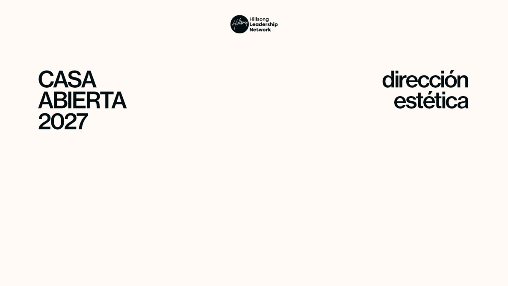
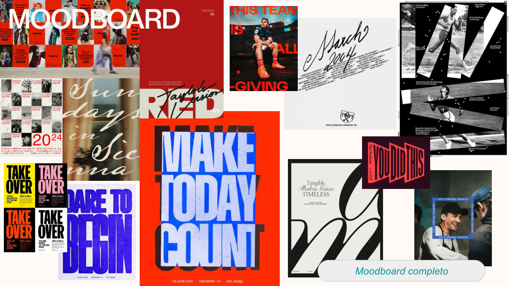
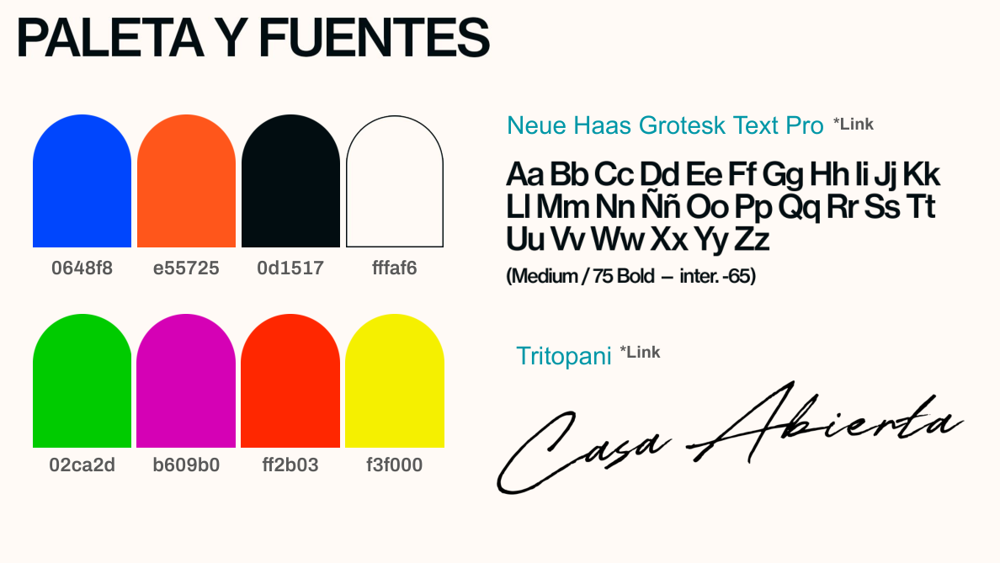
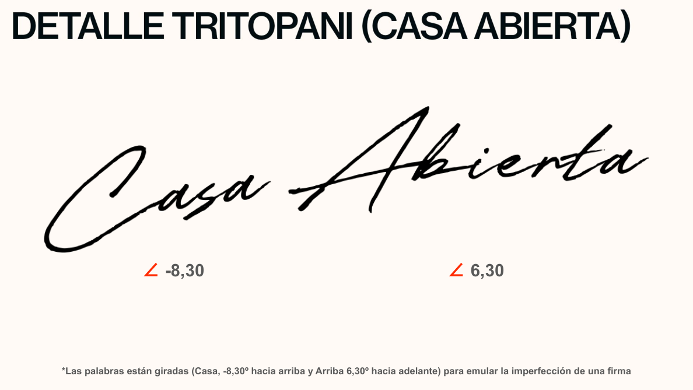
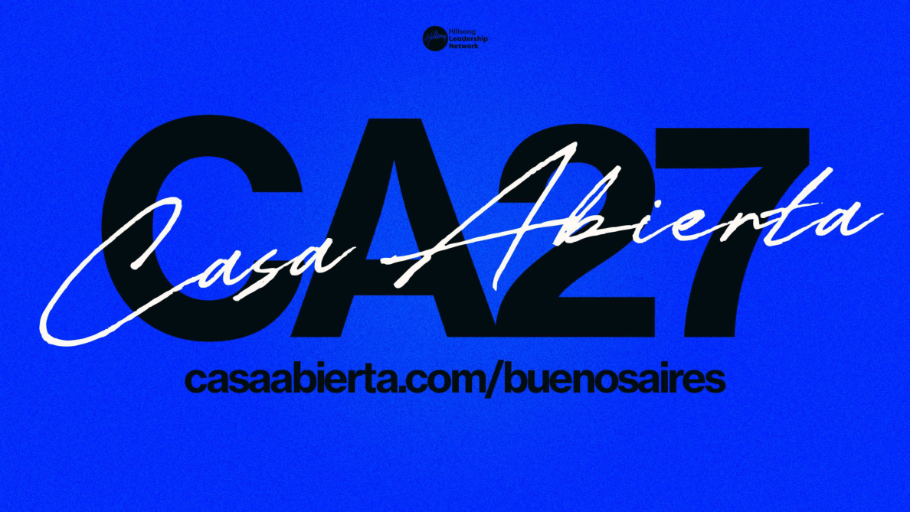
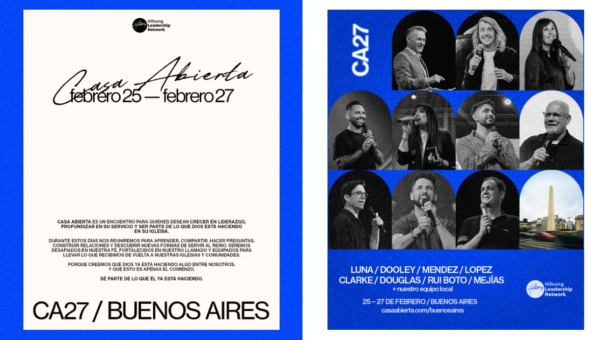
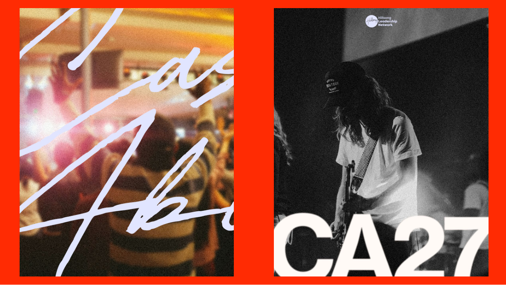
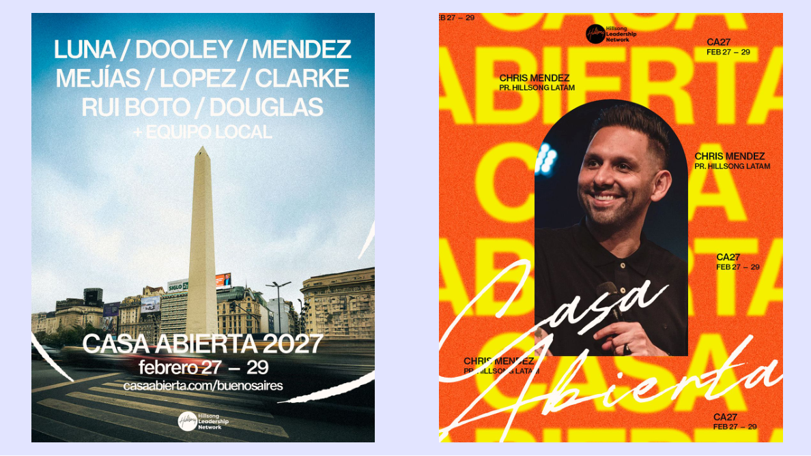
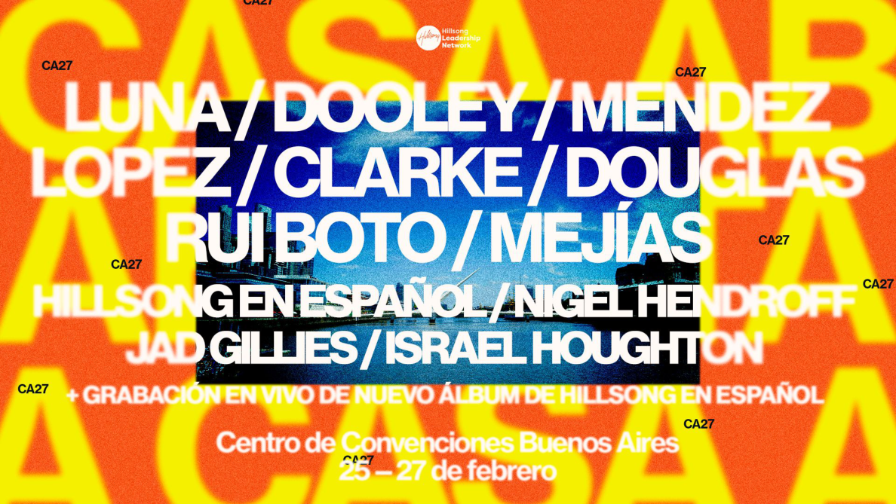
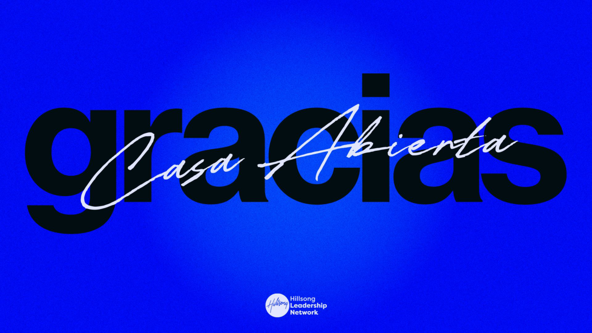

# CA27 — Casa Abierta 2027 | Dirección estética y especificación visual

> **Fuente primaria:** `CA27 - Dirección estética.pdf` (10 páginas). Documento reconstruido para lectura por Cursor o agentes de código. Incluye información escrita, decisiones visuales observables y referencias a imágenes locales, no solamente extracción de texto. **No es un archivo editable de diseño ni incluye los archivos fuente de los logos o de las fuentes.**
>
> **Convención de certeza:** **[FUENTE]** contenido expresamente indicado en el PDF; **[OBSERVACIÓN]** elementos visibles en sus composiciones; **[INTERPRETACIÓN]** traducción sugerida a reglas de implementación, no una especificación confirmada por el diseñador. Las imágenes vinculadas son las páginas originales rasterizadas y deben utilizarse como referencia visual autorizada.

## 0. Referencias visuales originales — índice

| Página | Contenido | Referencia |
|---|---|---|
| 1 | Portada e identidad del documento |  |
| 2 | Moodboard integral |  |
| 3 | Paleta, fuentes y muestra de lettering |  |
| 4 | Construcción y ángulos de la firma |  |
| 5 | Composición CA27 sobre azul |  |
| 6 | Dos composiciones informativas / cartel de speakers |  |
| 7 | Fotografía con lettering y gráfica musical |  |
| 8 | Gráfica de ciudad y pieza de orador |  |
| 9 | Afiche denso de lineup y grabación en vivo |  |
| 10 | Cierre «gracias» |  |

**Importante para Cursor:** Todas las rutas `assets/pages/` son relativas a este Markdown. Abrí la carpeta completa en Cursor, o usá el ZIP adjunto en la entrega. No proceses solo el Markdown ignorando las imágenes: contienen la mayor parte de la identidad visual.

---

## 1. Identidad y alcance

- **[FUENTE]** Nombre: **Casa Abierta 2027**.
- **[FUENTE]** Sigla o identificador gráfico usado en varias piezas: **CA27**.
- **[FUENTE]** Identidad acompañada por **Hillsong Leadership Network** (logotipo en portada y múltiples composiciones).
- **[FUENTE]** Nombre del documento: **Dirección estética**.
- **[FUENTE/OBSERVACIÓN]** Referencia web visible: **`casaabierta.com/buenosaires`**.
- **[OBSERVACIÓN]** Se utiliza tanto la denominación **Casa Abierta** como las marcas **CA27**, **CASA ABIERTA 2027** y la palabra **gracias**.
- **[OBSERVACIÓN]** Es una identidad para comunicación de evento, presentaciones de oradores, piezas sociales, información de fechas, contenidos promocionales y agradecimientos. No hay especificaciones técnicas de formatos y tamaños de salida en el PDF.

## 2. Concepto y lenguaje visual

### 2.1 Principios observados

1. **[OBSERVACIÓN]** Estilo editorial de alto impacto: jerarquías exageradas, tipografía sans serif gruesa y titulares muy grandes.
2. **[OBSERVACIÓN]** Contraste entre geometría tipográfica dura y una **firma manuscrita** inclinada y orgánica que atraviesa las composiciones.
3. **[OBSERVACIÓN]** Composiciones con capas: textos atrás de fotos, textos superpuestos a fotos, imágenes recortadas y elementos que exceden el encuadre.
4. **[OBSERVACIÓN]** Colores saturados con contraste elevado, alternados con soportes crema y fotografía monocroma.
5. **[OBSERVACIÓN]** Uso deliberado de composición densa, ritmo irregular, énfasis en nombres, diagonales y sensación de cartel/afiche.
6. **[OBSERVACIÓN]** Fotografías de escenario, comunidad y arquitectura urbana de Buenos Aires con tratamiento de grano, contraste o desenfoque.
7. **[INTERPRETACIÓN]** La identidad puede describirse para un generador como *editorial contemporánea, audaz, tipográfica, vibrante, imperfecta y con energía de evento en vivo*. Esta frase interpreta las referencias, no es un claim del documento.

### 2.2 Moodboard (página 2)


**[OBSERVACIÓN]** El collage incluye: layouts rojo/naranja y negro, fotografía editorial en composiciones de grilla, titulares condensados de gran escala, tarjetas de texto en capas, caligrafía manuscrita, fotografías deportivas y de personas, contrastes azul eléctrico–naranja, amarillo–negro, magenta–negro y fondos blanco/crema. Se ven composiciones de referencia con letras rotadas, tipografía desbordada y una estética de póster.

**[FUENTE]** Enlace al moodboard completo asociado en el PDF: https://pin.it/4bD8MMRLo

**No inferir:** el moodboard es inspiración, no una licencia para copiar literalmente marcas, fotografías, slogans, grillas o identidades de sus ejemplos.

---

## 3. Sistema de colores (página 3)

La página presenta **8 colores**. Los códigos se transcriben literalmente y se normalizan con `#` para CSS.

| Nombre de trabajo (agregado) | HEX — [FUENTE] | RGB calculado | Uso observado / precisión |
|---|---|---|---|
| Azul eléctrico | `#0648F8` | `6, 72, 248` | Fondo dominante en páginas 5, 6 y 10; algunos acentos del moodboard |
| Naranja | `#E55725` | `229, 87, 37` | Color de paleta; no confundir con rojo naranja de otras piezas |
| Negro azulado | `#0D1517` | `13, 21, 23` | Tipografía de alto impacto y elementos oscuros |
| Blanco crema | `#FFFAF6` | `255, 250, 246` | Fondos limpios y textos claros |
| Verde | `#02CA2D` | `2, 202, 45` | Color secundario explicitado en paleta; no se define su uso obligatorio |
| Magenta | `#B609B0` | `182, 9, 176` | Color secundario explicitado en paleta |
| Rojo naranja | `#FF2B03` | `255, 43, 3` | Se aproxima a los fondos cálidos vistos en ejemplos |
| Amarillo intenso | `#F3F000` | `243, 240, 0` | Acento intenso en afiches cálidos |

**[OBSERVACIÓN]** La lámina organiza los primeros cuatro swatches arriba y los otros cuatro abajo. **[INTERPRETACIÓN]** Puede ser útil distinguir estos dos grupos en el código, pero **el PDF no los denomina «primarios» y «secundarios»**.

```css
:root {
  --ca27-blue: #0648F8;
  --ca27-orange: #E55725;
  --ca27-ink: #0D1517;
  --ca27-cream: #FFFAF6;
  --ca27-green: #02CA2D;
  --ca27-magenta: #B609B0;
  --ca27-red-orange: #FF2B03;
  --ca27-yellow: #F3F000;
}
```

**[OBSERVACIÓN]** Las composiciones muestran variaciones aparentes de tonos por fotografía, grano, textura y exportación. Los **HEX oficiales** son los indicados arriba, no los colores muestreados a ojo de las imágenes renderizadas.


---

## 4. Tipografía (página 3)

### 4.1 Familia principal

- **[FUENTE]** Nombre: **Neue Haas Grotesk Text Pro**.
- **[FUENTE]** Nota de la lámina: **`(Medium /75 Bold – inter. -65)`**.
- **[FUENTE]** Página enlazada desde el archivo: https://fonts.adobe.com/fonts/neue-haas-grotesk
- **[OBSERVACIÓN]** Se utiliza en titulares mayúsculos, bloques de nombres, fechas, URL, piezas informativas y rótulos editoriales. Pesos robustos, composición muy compacta.
- **Advertencia:** la notación `inter. -65` probablemente alude a interletraje/tracking de la maqueta, pero el PDF **no indica unidades ni herramienta**. No traducir automáticamente a `letter-spacing: -65px`. Definir el espaciado final con calibración visual.
- **Advertencia:** `75 Bold` se reproduce como figura en la lámina; comprobar disponibilidad y nombre real de ese estilo antes de codificar `font-weight`.

### 4.2 Tipografía manuscrita / firma

- **[FUENTE]** Nombre: **Tritopani**.
- **[FUENTE]** Página enlazada desde el archivo: https://www.dafont.com/tritopani.font?text=Casa+Abierta
- **[FUENTE/OBSERVACIÓN]** Utilizada para crear la firma caligráfica **«Casa Abierta»**. Puede ocupar el primer plano, atravesar titulares grandes y quedar parcialmente fuera del encuadre.
- **[OBSERVACIÓN]** La firma se dibuja en negro cuando está sobre crema y en blanco/crema cuando está sobre azul, naranja o fotografía oscura.
- **Implementación:** revisar primero si existe un logo exportado en SVG/PNG; el efecto de firma final de la página 4 **no se consigue necesariamente escribiendo `Casa Abierta` en una sola línea con la fuente**: el diseñador aplicó giros separados a las palabras.

### 4.3 Tipos y archivos

El PDF **no adjunta archivos de fuentes `.otf` o `.ttf` ni concede derechos de redistribución**. Usar enlaces a sus proveedores y obtener licencias/archivos conforme corresponda. No sustituir silenciosamente estas fuentes como si fueran idénticas.

---

## 5. Construcción del lettering «Casa Abierta» (página 4)


- **[FUENTE]** Palabra **Casa**: rotación de **−8,30°**, descrita en la nota como «hacia arriba».
- **[FUENTE]** Palabra **Abierta**: rotación de **+6,30°**, descrita como «hacia adelante» en el texto; el cuerpo de la lámina lo identifica visualmente como *Abierta*.
- **[FUENTE]** Objetivo explícito: «**emular la imperfección de una firma**».
- **[OBSERVACIÓN]** La firma es de gran tamaño, su trazo fino contrasta con letras gruesas de fondo, y la unión entre palabras posee una continuidad visual casi caligráfica.
- **Nota de fidelidad:** el texto de la nota en el PDF dice literalmente «Casa, -8,30º hacia arriba y **Arriba** 6,30º hacia adelante». Es probable que «Arriba» sea un error por «Abierta», pero el documento no se modifica: usar el nombre visual **Abierta** y señalar la inconsistencia si se requiere precisión textual.

Ejemplo **orientativo** para prototipo web; requiere ajustar la posición de cada palabra según la referencia real:

```html
<div class="ca27-signature" aria-label="Casa Abierta">
  <span class="ca27-signature__casa">Casa</span>
  <span class="ca27-signature__abierta">Abierta</span>
</div>
```

```css
.ca27-signature { display: flex; align-items: center; white-space: nowrap; }
.ca27-signature__casa { transform: rotate(-8.3deg); }
.ca27-signature__abierta { transform: rotate(6.3deg); }
/* Valores de giro originales; espaciado, alineación y tamaños son a resolver. */
```

**[INTERPRETACIÓN]** Preferir un asset vectorial de la firma final cuando esté disponible: la forma real depende de interletraje, ligaduras y superposición entre ambas palabras.

---

## 6. Anatomía de piezas de comunicación

### Página 1 — Portada sobria


**[OBSERVACIÓN]** Fondo crema. Logo negro de Hillsong Leadership Network centrado cerca del borde superior. A la izquierda, `CASA / ABIERTA / 2027` con tres líneas, fuente gruesa negra. A la derecha, `dirección / estética` con dos líneas negras. Grandes márgenes y mucho espacio negativo; no utiliza colores de acento ni la firma caligráfica.

### Página 5 — Hero CA27


**[OBSERVACIÓN]** Fondo azul eléctrico con cierta textura. Logo institucional negro centrado arriba. `CA27` en tipografía sans negra enorme, casi ocupando todo el ancho. Firma **Casa Abierta** blanca atravesando las letras por el centro en diagonal y saliéndose del área de `CA27`. Debajo, URL grande negra `casaabierta.com/buenosaires`. El impacto surge de la superposición de negro y trazo blanco.

**[INTERPRETACIÓN]** Plantilla candidata para portada, hero de landing o pieza de reconocimiento de marca, siempre adaptando formato y legibilidad.

### Página 6 — Afiche informativo y cartel de oradores


**Pieza izquierda — [OBSERVACIÓN]** Fondo crema, logo institucional arriba. Firma negra centrada en zona superior junto a fechas `febrero 25 — febrero 27`. Bloque pequeño de presentación del evento colocado más abajo. Cierre `CA27 / BUENOS AIRES` grande al pie.

**Texto explicativo de la pieza izquierda — transcripción visual con posibles variaciones mínimas de puntuación:**

> CASA ABIERTA ES UN ENCUENTRO PARA QUIENES DESEAN CRECER EN LIDERAZGO, PROFUNDIZAR EN SU SERVICIO Y SER PARTE DE LO QUE DIOS ESTÁ HACIENDO EN SU IGLESIA.
>
> DURANTE ESTOS DÍAS NOS REUNIREMOS PARA APRENDER, COMPARTIR, HACER PREGUNTAS, CONSTRUIR RELACIONES Y DESCUBRIR NUEVAS FORMAS DE SERVIR AL REINO. SEREMOS DESAFIADOS EN NUESTRA FE, FORTALECIDOS EN NUESTRO LLAMADO Y EQUIPADOS PARA LLEVAR LO QUE RECIBIMOS DE VUELTA A NUESTRAS IGLESIAS Y COMUNIDADES.
>
> PORQUE CREEMOS QUE DIOS YA ESTÁ HACIENDO ALGO ENTRE NOSOTROS. Y QUE ESTO ES APENAS EL COMIENZO.
>
> SÉ PARTE DE LO QUE ÉL YA ESTÁ HACIENDO.

**Pieza derecha — [OBSERVACIÓN]** Fondo azul. Mosaico de **10 recortes aproximadamente** en arcos de medio punto / retratos verticales, principalmente en blanco y negro; uno de los cuadros representa el Obelisco de Buenos Aires. Identificador `CA27` blanco dispuesto verticalmente a la izquierda. Abajo listado de apellidos en blanco, fechas, ubicación y URL; logo Hillsong Leadership Network en blanco abajo a la derecha.

**[FUENTE VISUAL]** Texto de esta pieza: `LUNA / DOOLEY / MENDEZ / LOPEZ / CLARKE / DOUGLAS / RUI BOTO / MEJIAS / + nuestro equipo local`; `25 – 27 DE FEBRERO / BUENOS AIRES`; `casaabierta.com/buenosaires`.

### Página 7 — Fotografía emocional y música


**Izquierda — [OBSERVACIÓN]** Imagen cálida de evento/comunidad con desenfoque y luz intensa; el lettering manuscrito blanco está a una escala mucho mayor que el encuadre y sus trazos aparecen cortados deliberadamente. Sensación inmersiva y cinematográfica.

**Derecha — [OBSERVACIÓN]** Fotografía blanco y negro de una persona tocando guitarra sobre escenario, granular y contrastada. Logo blanco pequeño centrado arriba. Letras `CA27` en blanco, enormes, en zona inferior, parcialmente cortadas por borde del formato. Contraste extremo entre foto documental y tipografía gráfica.

### Página 8 — Buenos Aires y speaker individual


**Izquierda — [OBSERVACIÓN]** Fotografía color de la Avenida 9 de Julio/Obelisco, encuadre vertical, cielo azul claro y ciudad al fondo. Texto blanco grande con apellidos de oradores alineado arriba y `+ EQUIPO LOCAL`. Texto centrado abajo `CASA ABIERTA 2027`, debajo `febrero 27 – 29` y URL. Trazos de firma blanca superpuestos en parte inferior/laterales. Logo blanco en la parte baja.

**Derecha — [OBSERVACIÓN]** Afiche de speaker con fondo naranja/rojo, letras amarillas gigantes repetidas y cortadas, foto retrato del orador recortada en arco de medio punto (tope redondeado), rótulos negros pequeños con nombre/cargo y `CA27 FEB 27 – 29`; firma manuscrita blanca de gran escala en primer plano cruzando el retrato y fondo. Logo institucional negro arriba.

**[FUENTE VISUAL]** Speaker identificado: `CHRIS MENDEZ` / `PR. HILLSONG LATAM`.

### Página 9 — Afiche de programación / lineup


**[OBSERVACIÓN]** Fondo naranja vivo con letras amarillas gigantes, muy recortadas. Imagen central fotográfica en tonalidades azules/oscuras. Sobreimpresión de nombres blancos sans enormes, líneas múltiples, apenas contenidas dentro de márgenes. Repetición decorativa de `CA27` en tamaño pequeño. Logo de Hillsong Leadership Network blanco en la parte superior. Información del evento en el tercio inferior, toda tipográficamente densa.

**[FUENTE VISUAL]** Listado que aparece en esta versión del afiche:

- `LUNA / DOOLEY / MENDEZ`
- `LOPEZ / CLARKE / DOUGLAS`
- `RUI BOTO / MEJÍAS`
- `HILLSONG EN ESPAÑOL / NIGEL HENDROFF`
- `JAD GILLES / ISRAEL HOUGHTON`
- `+ GRABACIÓN EN VIVO DE NUEVO ÁLBUM DE HILLSONG EN ESPAÑOL`
- `Centro de Convenciones Buenos Aires`
- `25 — 27 de febrero`

**Atención:** la lectura de nombres proviene de texto incorporado a una imagen; confirmar ortografía con la organización para una pieza pública.

### Página 10 — Agradecimiento


**[OBSERVACIÓN]** Fondo azul saturado. Palabra **`gracias`** en sans negrísima, casi todo el ancho, negra y en minúscula; firma `Casa Abierta` blanca superpuesta en diagonal. Logo Hillsong Leadership Network en blanco centrado abajo. Ejemplo de uso expresivo que no necesita más información.

---

## 7. Componentes que se pueden construir en una interfaz

> Los siguientes componentes son **[INTERPRETACIÓN]** basada en las piezas; **no** son componentes definidos oficialmente en el PDF.

| Componente | Construcción / variantes | Referencia |
|---|---|---|
| `InstitutionalLogo` | Negro o blanco, pequeño, centrado superior o en esquina inferior | P1, P5, P6, P8, P9, P10 |
| `CasaAbiertaSignature` | Lettering de dos palabras inclinado, con versiones clara/oscura; posibilidad de quedar recortado | P3–P5, P7, P8, P10 |
| `CA27Display` | Titular sobredimensionado, sans muy pesado, negro sobre azul o blanco sobre foto | P5, P7 |
| `BrandedPoster` | Fondo pleno saturado + tipografía gigante + fotografía y capas | P8 derecha, P9 |
| `SpeakerArchPortrait` | Recorte fotográfico con parte superior semicircular y base recta | P6 derecha, P8 derecha |
| `SpeakerLineup` | Lista compacta de nombres con separador `/` en mayúsculas | P6, P8, P9 |
| `EventInformation` | Fecha, ciudad, lugar, URL; versiones compacta y extensa | P5, P6, P8, P9 |
| `PhotoTreatment` | Blanco y negro de alto contraste o imagen cálida desenfocada; posible grano | P6–P9 |
| `ThankYouCard` | `gracias` negra gigante, firma blanca encima y logo blanco al pie | P10 |

## 8. Reglas sugeridas para implementar en web o generar piezas

Las siguientes son traducciones prácticas **[INTERPRETACIÓN]**, no normas de marca verificadas:

1. Mantener la paleta definida; elegir una base protagonista por pieza y aplicar contraste fuerte.
2. Priorizar una única jerarquía gigante, normalmente `CA27`, `CASA ABIERTA`, nombres de oradores o `gracias`.
3. Contrastar sans bold geométrica con firma manuscrita mucho más gestual.
4. Permitir que titulares/firma se corten intencionadamente dentro de la pieza; evitar recortes accidentales que afecten fecha, URL, nombres o llamadas principales.
5. Usar `position: relative`/`absolute`, capas y `overflow: hidden` por pieza, en vez de estructurar todo como una grilla uniforme.
6. Mantener las fotografías como parte fundamental de la composición; no reemplazar con bloques vacíos si se busca reproducir el estilo.
7. En listas de speakers, usar nombres grandes con `/`, grillas de retratos y tratamiento fotográfico coherente.
8. Usar controles de contraste y tamaño mínimo para que las piezas densas sigan siendo legibles en dispositivos móviles.
9. Recrear el lettering como asset original cuando sea posible; no aplicar `font-style: italic` a una tipografía cualquiera.
10. El aspecto granular/texturado es visible pero el documento no ofrece parámetros de ruido, filtros ni blending; ajustar por comparación con páginas originales.

### Qué no está definido

- Tamaños exactos, relación de aspecto normativa de cada pieza, márgenes, columnas y breakpoints.
- Diseño final de sitio web, interacciones, animaciones, accesibilidad, estados responsivos o navegación.
- Contenido final aprobado del evento, cronograma, registro y CTA.
- Archivos maestros SVG/AI/Figma, versiones editables de logos, fuentes licenciadas, imágenes originales ni derechos de uso.
- Sistema de espaciado, escalas tipográficas, valores oficiales de `line-height`, tamaños o tracking CSS.
- Qué variación de fecha o lineup es la definitiva.

---

## 9. Información textual de evento y ambigüedades

| Elemento | Aparece en | Lectura del PDF | Observación |
|---|---|---|---|
| Marca | P1–P10 | Casa Abierta 2027 / CA27 | Coexisten marca escrita y monograma |
| Organizador/identidad asociada | Varias | Hillsong Leadership Network | La marca institucional se ve como logo gráfico |
| Ciudad | P5, P6, P8 | Buenos Aires | La línea `CA27 / BUENOS AIRES` aparece en P6 |
| URL | P5, P6, P8 | `casaabierta.com/buenosaires` | Transcribir así; no se verificó externamente |
| Fechas A | P6 y P9 | **25–27 de febrero** | Composición izquierda de P6 y afiche P9 |
| Fechas B | P8 | **27–29 de febrero** | Composiciones de ciudad y speaker en P8 |
| Lugar | P9 | Centro de Convenciones Buenos Aires | Único lugar explícito visible |
| Equipo local | P6, P8 | `+ nuestro equipo local` / `+ EQUIPO LOCAL` | Distintos tratamientos |
| Actividad | P9 | Grabación en vivo de nuevo álbum de Hillsong en Español | Aparece como claim del afiche |

**IMPORTANTE: inconsistencia de fechas.** El material visual incluye **25–27** y **27–29** de febrero. Además, febrero de **2027 tiene 28 días**, por lo que **29 de febrero de 2027 no existe**. No codificar `27–29 de febrero de 2027` como fecha válida sin aprobación. Para una publicación final, confirmar la programación con el responsable del evento. Esta comprobación calendárica es externa al PDF.

**IMPORTANTE: inconsistencias nominales.** En P4 la explicación impresa dice «Arriba» aunque la firma dice «Abierta». Los nombres de speakers varían entre piezas y se ven variantes de acentuación (`MENDEZ / MÉNDEZ`, `MEJIAS / MEJÍAS`); confirmar lista oficial antes de publicar.

---

## 10. Guía de tareas para un agente en Cursor

```md
Implementá una identidad visual para CA27 / Casa Abierta 2027 tomando
como fuente principal CA27-DIRECCION-ESTETICA.md y las diez imágenes
assets/pages/pagina-01.png ... pagina-10.png.

Requisitos:
- Respetar exactamente los 8 colores HEX de la página 3.
- Usar Neue Haas Grotesk Text Pro y Tritopani solo si se cuenta con
  sus archivos/licencias; documentar sustituciones provisionales.
- Reproducir el contraste entre tipografía sans muy pesada y firma
  caligráfica irregular. Casa -8.3°, Abierta +6.3° como referencia.
- Considerar páginas 5, 6, 7, 8, 9 y 10 como ejemplos gráficos de
  aplicación, y la página 2 como moodboard, no como assets a copiar.
- Construir componentes reutilizables para monograma CA27, firma,
  lineup, retratos arqueados, datos de fecha/lugar y logo institucional.
- Verificar visualmente contra imágenes del PDF para composición,
  jerarquía, contraste, escala, solapamientos, grano y recortes.
- NO inventar fotos de speakers, logos oficiales ni fechas confirmadas.
- La fecha 27–29 de febrero de 2027 es inválida: marcar para revisión.
- Pedir los assets finales y confirmar la fecha correcta antes de
  publicar una implementación de producción.
```

---

## 11. Procedencia y límites

- Archivo base incluido en la entrega ZIP: `original/CA27 - Dirección estética.pdf`.
- Las 10 imágenes PNG en `assets/pages/` son **renders fieles de cada página**. Conservan texto que el extractor PDF no detecta, fotografías, moodboard, muestras cromáticas, construcción del lettering, composición y logos visibles.
- Este Markdown reconstruye las decisiones de diseño accesibles en el PDF, pero **no crea artificialmente capas editables o archivos maestros que el PDF no proporciona**.
- Los enlaces de fuente y del moodboard son vínculos incrustados en el PDF; no se comprobó su disponibilidad en línea.
